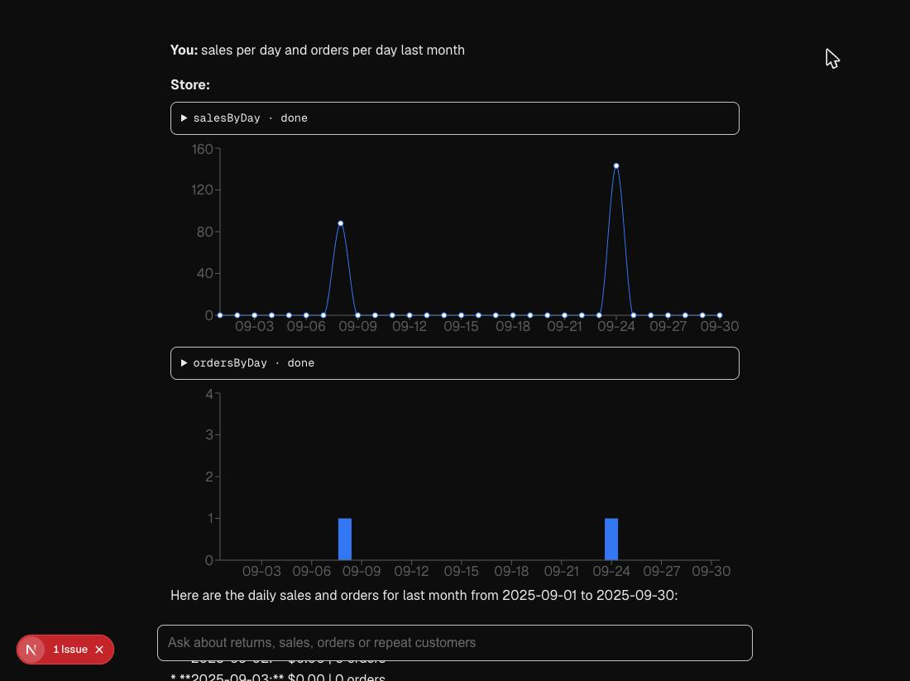
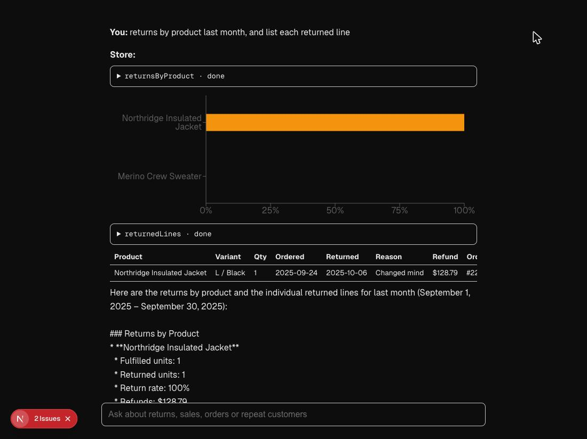
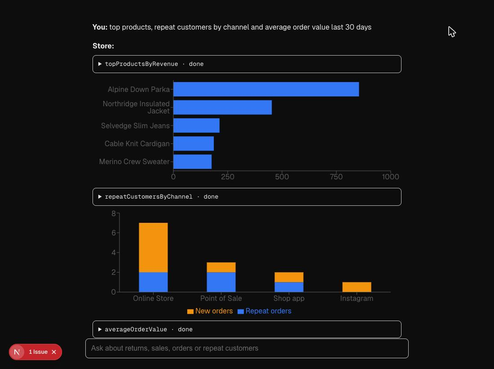
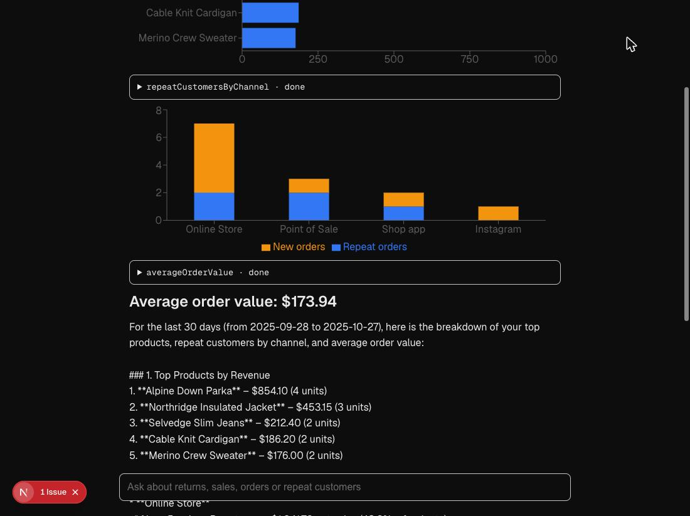
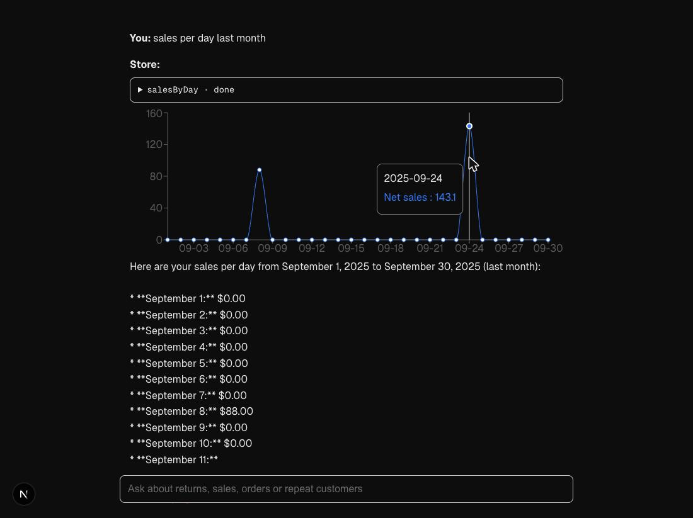
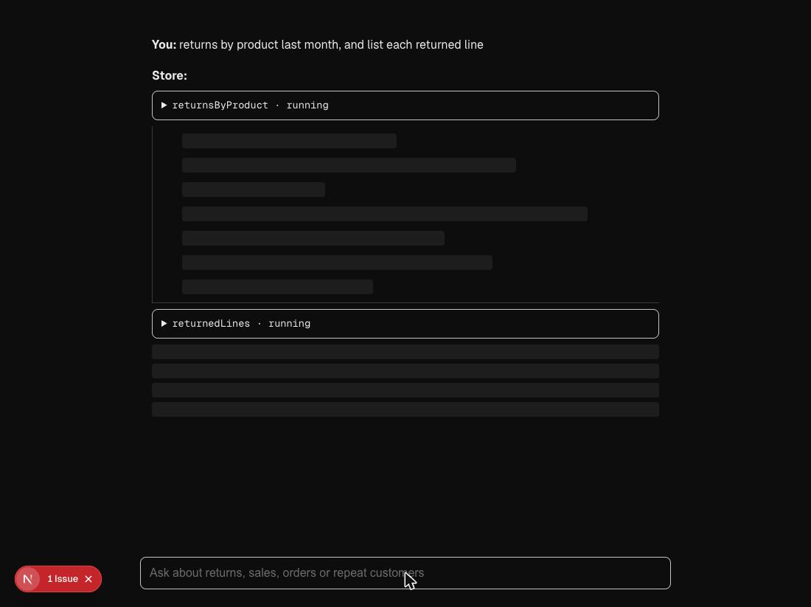
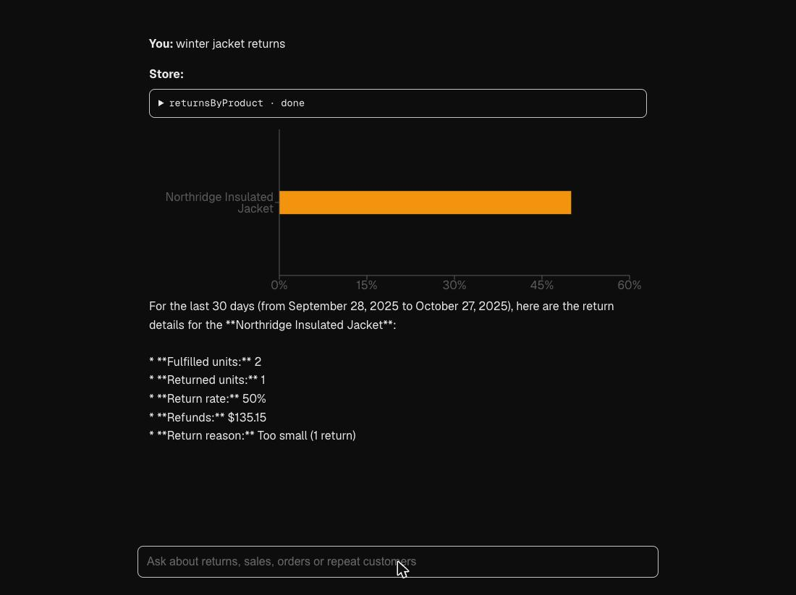

# Store Metrics

Metrics that a store owner can ask about, calculated from a Shopify order history CSV.
Next.js (App Router), TypeScript, Vitest, pnpm.

## Setup

```bash
pnpm install
pnpm test        # Vitest, uses the real CSV values
pnpm lint        # ESLint
pnpm build       # Next.js production build
pnpm dev         # Next.js dev server
```

## Order file

- Default: `data/order-history.csv`. One row is one order line item, 2025-05-06 to 2025-10-27.
- Set `ORDERS_PATH` to read a different file (for example, a different file in each environment).

```bash
ORDERS_PATH=/path/to/orders.csv pnpm test
```

## Metrics

Each function is in `src/lib/metrics/`. Each one takes `(start, end)` as `"YYYY-MM-DD"`, includes both days, and reads the order file.
A date that is not valid, or a start after the end, gives an error. A range with no orders gives 0, not an error.

| Metric | Function | Merchant decision |
|---|---|---|
| returns_by_product | `returnsByProduct` | Reorder: do not reorder a product that comes back. Fix the size chart when the reason is size. Rate = returned ÷ fulfilled units. |
| returned_lines | `returnedLines` | Reorder by variant: see which size or color came back, and why. The range is the return date ("what came back last week"). `returnsByProduct` uses the order date, for the return rate of those orders. |
| sales_by_day | `salesByDay` | Find the strong and weak days, to time promotions and plan cash. |
| orders_by_day | `ordersByDay` | Plan packing and shipping staff for busy days. |
| average_order_value | `averageOrderValue` | Set the free-shipping threshold and bundle prices. |
| top_products_by_revenue | `topProductsByRevenue` | Reorder the products that sell. Read it with returns: revenue is before refunds. |
| repeat_customers_by_channel | `repeatCustomersByChannel` | Spend the retention budget on the channels that bring customers back. |

Definitions: [`docs/metrics.md`](docs/metrics.md). Date phrases: [`docs/date-rules.md`](docs/date-rules.md).

## Date rule: fixed today

The data ends on 2025-10-27, so "today" is fixed at **Tuesday, 2025-10-28**.
A week is Monday to Sunday, so **last week = 2025-10-20 to 2025-10-26**.

## Chat

The owner asks a question on the home page. The answer streams character by character.

```bash
# .env
OPENROUTER_API_KEY=...
OPENROUTER_MODEL=google/gemini-3.5-flash-lite   # default if not set
STORE_TODAY=2025-10-28                        # fixed today for this dataset; not set = the real date
```

| File | Job |
|---|---|
| `src/app/api/chat/route.ts` | `POST /api/chat`. AI SDK `streamText` with the tools, `isStepCount(5)`, `createUIMessageStreamResponse`. Instructions give today and the date rules. |
| `src/app/page.tsx` | `useChat` from `@ai-sdk/react`. Shows text as it arrives and the name of each tool call. |
| `src/lib/chat/tools.ts` | One tool for each metric. Descriptions use the words that merchants typed (`merchant_report_requests_oct27_*.xlsx`), for example "jakets returnd last wk". |
| `src/lib/chat/dates.ts` | Changes the date phrase into `start` and `end` with `docs/date-rules.md`. |

How a question goes to a tool:

1. The model selects the tool from its description. "Came back" goes to `returnedLines` when the subject is a product, and to `repeatCustomersByChannel` when the subject is a customer. "Return rate" goes to `returnsByProduct`.
2. The model gives the date phrase as `range.period` (`lastWeek`, `lastNDays` + `days`, `month` + `month`, `between` + `start`/`end`). It does not calculate dates. The code calculates them, because a model makes errors with weekdays and month ends.
3. Some tools take more inputs: `returnsByProduct` and `returnedLines` take `productTitle` ("parka") and `category` ("jackets" → `Outerwear`), and `topProductsByRevenue` takes `limit` ("top 10").
4. Each tool result has `start`, `end`, `hasOrders` and `result`. The answer gives the exact dates. When `hasOrders` is false, it says "There are no orders from <start> to <end>".
5. The data has no ad spend, ROAS, cost or stock. The model says this and does not use the nearest tool.

### Charts

The chat shows one chart (or table) below each tool result (`src/app/metric-chart.tsx`, Recharts). When `hasOrders` is false, it shows no chart.
While the tool runs, a gray skeleton of the same chart type shows in its place (`src/app/chart-skeleton.tsx`), at the same height, so the page does not move. If the request fails or stops, the skeleton goes.

| Metric | Chart | Why this chart |
|---|---|---|
| returned_lines | Bar (horizontal), returned units, and a table | The bar shows which product came back the most. The owner reads each line (variant, return date, reason) to decide the reorder. A chart cannot show text values. |
| sales_by_day | Line | Sales is a trend over time. A line shows the rise and fall from day to day. |
| orders_by_day | Bar (vertical) | An order count is a whole number for each day. A bar shows the busy days clearly. |
| average_order_value | One number, no chart | The result is one value. A chart of one value gives no more information. |
| top_products_by_revenue | Bar (horizontal) | It is a ranked list. Long product titles are easy to read on the vertical axis. |
| returns_by_product | Bar (horizontal), return rate % | It compares products. Highest rate is first, so the product to stop reordering is at the top. |
| repeat_customers_by_channel | Stacked bar | Each channel bar is all its orders, split into repeat and new. You see the size and the share together. |

Screenshots (dark mode, `STORE_TODAY=2025-10-28`):

| Question | Screenshot |
|---|---|
| "sales per day and orders per day last month": line and bar |  |
| "returns by product last month, and list each returned line": horizontal bar and table |  |
| "top products, repeat customers by channel and average order value last 30 days": horizontal bar and stacked bar |  |
| Same question: average order value as one number |  |
| "sales per day last month", mouse on 2025-09-24: the tooltip gives the full date and the value |  |
| Skeletons while the tools run (horizontal bar and table) |  |

Errors: in dev the stream shows the cause (for example, a rate limit). In prod it shows "The answer failed. Try again."

### Model: why Gemini 3.5 Flash Lite, not Gemma 4 31B (free)

We started with `google/gemma-4-31b-it:free`. It accepts `tools` and `tool_choice` for function calling, and `response_format` for JSON output without JSON-schema enforcement. Thus `dates.ts` calculates the dates and zod checks the tool inputs, not the model.

The free models have a high rate limit. Only one upstream provider (Google AI Studio) serves the free Gemma, and all OpenRouter users share it. Most of our requests failed with 429 "temporarily rate-limited upstream". One request selected the correct tool, but the second step (the answer) got the 429.

We had a paid Gemini key, so we added it to OpenRouter (BYOK) and changed to `google/gemini-3.5-flash-lite`:

- It also accepts `tools`, `tool_choice`, `response_format` and `structured_outputs`.
- It answered the real merchant questions on the first try (see the terminal output below).
- It is fast and costs little: $0.30 per million input tokens and $2.50 per million output tokens. One question uses two model calls (tool call, then answer).

To change the model, set `OPENROUTER_MODEL`. The code does not change.

### Claude Code instruction for the chat (quote)

```text
Build the chat streaming route that will print the character as they arrive , use vercel ai sdk
built in functions for it , the docs of the ai sdk are here https://ai-sdk.dev/docs/introduction
and that should include tools as a context so it routes to correct tools .
Use the OPENROUTER_MODEL and OPENROUTER_API_KEY for the AI Engine , metrics functions and their
description are in the md files
each tool should be taking different different inputs based on the question like when merchant
type last week , use todays date and previous week see the @docs/date-rules.md
```

### Terminal output for one question

Real merchant question CRR-25-10-27-0251, with `STORE_TODAY=2025-10-28`:

```bash
curl -N -X POST localhost:3000/api/chat -H 'Content-Type: application/json' \
  -d '{"messages":[{"id":"1","role":"user","parts":[{"type":"text","text":"top 10 products by revenue Oct 1 to Oct 15"}]}]}'
```

`pnpm dev` terminal (the route logs each step):

```text
[chat] question: "top 10 products by revenue Oct 1 to Oct 15"
[chat] step 0 tool call: topProductsByRevenue {"range":{"period":"between","start":"2025-10-01","end":"2025-10-15"},"limit":10}
[chat] step 0 tool result: topProductsByRevenue {"start":"2025-10-01","end":"2025-10-15","hasOrders":true,"result":[{"productId":"P-1001","productTitle":"Alpine Down Parka","units":3,"revenue":657},{"productId":"P-1002","productTitle":"Northridge Insulated Jacket","units":2,"revenue":294.15},{"productId":"P-1008","productTitle":"Selvedge Slim Jeans","units":2,"revenue":212.4},{"productId":"P-1005","productTitle":"Cable Knit Cardigan","units":1,"revenue":98},{"productId":"P-1011","productTitle":"Leather Gloves","units":1,"revenue":46},{"productId":"P-1010","productTitle":"Wool Beanie","units":1,"revenue":24}]}
[chat] step 1 answer: From October 1 to October 15, 2025, here are the top products by revenue:

1. **Alpine Down Parka** – $657.00 (3 units)
2. **Northridge Insulated Jacket** – $294.15 (2 units)
3. **Selvedge Slim Jeans** – $212.40 (2 units)
4. **Cable Knit Cardigan** – $98.00 (1 unit)
5. **Leather Gloves** – $46.00 (1 unit)
6. **Wool Beanie** – $24.00 (1 unit)
```

The model selected `topProductsByRevenue`, set `limit` to 10 from "top 10", and gave the exact dates. Only 6 products had sales in the range, so the answer has 6 rows.

## Live demo and acceptance results

Live app, open to anyone with no sign-in: https://store-metrics-zero-ndg2.vercel.app (Vercel, production, `STORE_TODAY=2025-10-28`).

On 2026-11-25 we asked the live app the winter jacket question and 5 questions from Erik Vogt's acceptance set (`Erik Vogt's Acceptance Question Set for the Live Dashboard.xlsx`). Each question was asked in a new chat in Chrome. "Seconds to first chart" is from Enter to the first chart or table on the page. "Correct call" uses Erik's rule: the correct tool, date range and filter. We also checked each answer against `data/order-history.csv`.

| ID | Question | Tool called | Arguments sent | Correct call | Rendered without crash | Seconds to first chart |
|---|---|---|---|---|---|---|
| — | winter jacket returns | `returnsByProduct` | no range (default last 30 days: 2025-09-28..2025-10-27), `productTitle: "jacket"` | N | Y | 3.17 |
| AQ-01 | sales last 30 days online store only | `salesByDay` | `lastNDays` 30 → 2025-09-28..2025-10-27 | N | Y | 1.10 |
| AQ-03 | which jackets came back the most last week | `returnsByProduct` ×2, `returnedLines` | `lastWeek` → 2025-10-20..2025-10-26, `productTitle: "jacket"` / `"parka"` | Y | Y | 1.15 |
| AQ-07 | what's my ad spend on Meta this month | none | — | Y | Y | — (no chart, as expected) |
| AQ-10 | how many ppl bought twice in october | `repeatCustomersByChannel` | `month` 10, 2025 → 2025-10-01..2025-10-31 | Y | Y | 1.15 |
| AQ-16 | top return reasons for jakets in september | `returnsByProduct` ×2 | `month` 9, 2025, `productTitle: "jaket"`, then `"jacket"` | Y | Y | 2.16 |

Score for these 6: correct call 4 of 6, render crashes 0, slowest first chart 3.17 s. Erik's pass rules are at least 18 of 20 correct calls, 0 crashes, and under 5.0 s on every question. Thus the crash and time rules pass here, but a 4-of-6 rate would fail the call rule.



What the answers got wrong (checked against the CSV):

- **Winter jacket returns:** the tool filters by product title only, so "jacket" finds only the Northridge Insulated Jacket (1 return). The CSV has `product_category`, and 4 Outerwear lines were returned in the range: 3 Alpine Down Parka (Too small, Too large, Defective) and 1 jacket. The answer misses the 3 parka returns.
- **AQ-01:** the sales tool has no channel filter, and the answer says the data does not separate channels. That is not true: the CSV has `sales_channel`. The Online Store total is $1,413.10. The model also added the days itself and gave a wrong total: $2,263.25 in one run and $2,410.25 in another. The correct total for all channels is $2,261.25. The range is one day later than Erik expects (2025-09-27..2025-10-26), because our fixed today is 2025-10-28.
- **AQ-03:** the call matches Erik's range and filter, but the answer "no returns for jackets last week" is wrong for the merchant. The range uses the order date. By return date, 4 Outerwear items came back from 2025-10-20 to 2025-10-26: 3 Alpine Down Parka and 1 Northridge Insulated Jacket.
- **AQ-10:** correct. Note that "repeat" means the customer bought before, not exactly twice.
- **AQ-16:** the model first sent the misspelled "jaket", got an empty chart, and then sent "jacket". The answer (1 return, "Changed mind") is correct. In one other run (an HTTP client, not the browser), the stream stopped in the middle of the answer with "The answer failed. Try again."

Changes that would fix these misses: a category filter on the product tools, a channel filter on the sales tools, a return-date range for "came back" questions, and a total in each tool result so that the model does not add numbers.

## Output for last week

```text
$ returnsByProduct("2025-10-20", "2025-10-26")
  {"productId":"P-1009","productTitle":"Utility Chino","fulfilledUnits":1,"returnedUnits":1,"returnRate":100,"refunds":74,"reasons":{"Changed mind":1}}
  {"productId":"P-1001","productTitle":"Alpine Down Parka","fulfilledUnits":0,"returnedUnits":0,"returnRate":0,"refunds":0,"reasons":{}}
  {"productId":"P-1011","productTitle":"Leather Gloves","fulfilledUnits":1,"returnedUnits":0,"returnRate":0,"refunds":0,"reasons":{}}
  {"productId":"P-1002","productTitle":"Northridge Insulated Jacket","fulfilledUnits":0,"returnedUnits":0,"returnRate":0,"refunds":0,"reasons":{}}
  {"productId":"P-1010","productTitle":"Wool Beanie","fulfilledUnits":3,"returnedUnits":0,"returnRate":0,"refunds":0,"reasons":{}}

$ salesByDay("2025-10-20", "2025-10-26")
  {"date":"2025-10-20","netSales":0}
  {"date":"2025-10-21","netSales":159}
  {"date":"2025-10-22","netSales":0}
  {"date":"2025-10-23","netSales":238.5}
  {"date":"2025-10-24","netSales":0}
  {"date":"2025-10-25","netSales":72}
  {"date":"2025-10-26","netSales":74}

$ ordersByDay("2025-10-20", "2025-10-26")
  {"date":"2025-10-20","orderCount":0}
  {"date":"2025-10-21","orderCount":1}
  {"date":"2025-10-22","orderCount":0}
  {"date":"2025-10-23","orderCount":1}
  {"date":"2025-10-24","orderCount":0}
  {"date":"2025-10-25","orderCount":1}
  {"date":"2025-10-26","orderCount":1}

$ averageOrderValue("2025-10-20", "2025-10-26")
  135.88

$ topProductsByRevenue("2025-10-20", "2025-10-26")
  {"productId":"P-1001","productTitle":"Alpine Down Parka","units":1,"revenue":197.1}
  {"productId":"P-1002","productTitle":"Northridge Insulated Jacket","units":1,"revenue":159}
  {"productId":"P-1009","productTitle":"Utility Chino","units":1,"revenue":74}
  {"productId":"P-1010","productTitle":"Wool Beanie","units":3,"revenue":72}
  {"productId":"P-1011","productTitle":"Leather Gloves","units":1,"revenue":41.4}

$ repeatCustomersByChannel("2025-10-20", "2025-10-26")
  summary.repeat {"orderCount":2,"customerCount":2,"netSales":231,"averageOrderValue":115.5,"refundRate":0}
  summary.new    {"orderCount":2,"customerCount":2,"netSales":312.5,"averageOrderValue":156.25,"refundRate":23.7}
  {"salesChannel":"Online Store","orderCount":2,"repeatOrderShare":50}
  {"salesChannel":"Point of Sale","orderCount":2,"repeatOrderShare":50}
```

The parka and the jacket show 0 fulfilled units last week because both orders are not shipped. Their return rate is not known yet.

## Claude Code prompt (excerpt)

```text
Metrics (write them in docs/metrics.md, one function each in src/lib/metrics/):
- returnsByProduct: for each product: fulfilled units, returned units,
  return rate = returned ÷ fulfilled units, refunds, count of each reason.
- repeatCustomersByChannel: {summary: {repeat, new}, breakdowns: {salesChannel: [...]}}.
Inputs: each function takes (start, end) as "YYYY-MM-DD", includes both days, and reads
the CSV. Throw if a date is not valid or start > end.
```

**Changed or rejected:** I rejected the first list of 32 metrics because it gave money totals with no product or day. I kept 6 metrics, each with a merchant decision. I changed the return rate to divide by fulfilled units, not all units sold, because an unshipped unit cannot come back. I moved the logic from Python to Next.js, and changed npm to pnpm.
